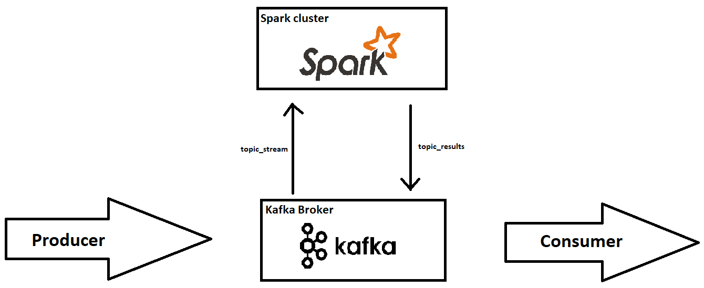
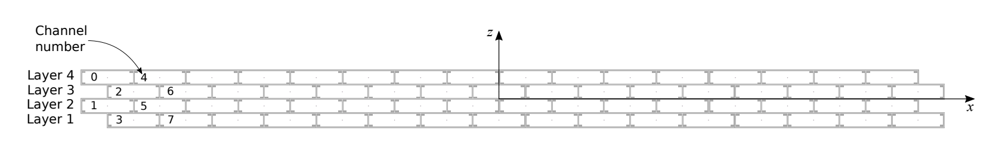
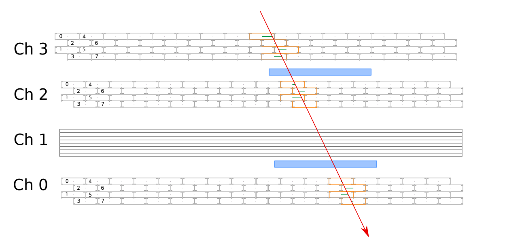

# Cosmic Rays · Live Detector Monitor

A small distributed streaming application for **real-time quality monitoring of mini Drift Tube (miniDT) cosmic-ray detectors**.

The project streams detector data from Cloud Veneto object storage into **Apache Kafka**, processes each micro-batch with **Spark Structured Streaming**, publishes compact monitoring summaries back to Kafka, and visualises them in a live dashboard.



## Architecture

```text
Cloud Veneto / S3
       │
       ▼
  cosmic-producer
       │
       ▼
 Kafka · topic_stream
       │
       ▼
 Spark Structured Streaming
       │
       ▼
 Kafka · topic_results
       │
       ▼
  cosmic-dashboard
```

The refactored application preserves the original Kafka topics, message schema, detector mapping, Spark master defaults, micro-batch processing, and histogram definitions. The original notebooks are retained under [`notebooks/legacy`](notebooks/legacy) as a reference implementation.

## What is monitored

For each Spark micro-batch the application computes:

- total number of detector hits after cleansing;
- hits per chamber;
- active TDC-channel histograms per chamber;
- distribution of active TDC channels per orbit;
- active-channel histograms for orbits containing a scintillator signal;
- processing time for the batch.

The detector-side cleansing and chamber mapping are unchanged from the notebook implementation.

## Repository layout

```text
.
├── assets/                 # Architecture and detector figures
├── notebooks/legacy/       # Original notebook workflow, kept as fallback
├── scripts/                # Spark/Kafka cluster helpers
├── src/cosmic_rays/
│   ├── config.py           # Environment-driven configuration
│   ├── producer.py         # S3 -> Kafka
│   ├── processing.py       # Kafka -> Spark -> Kafka
│   ├── dashboard.py        # Standalone live Matplotlib dashboard
│   └── messages.py         # Shared result-message utilities
├── tests/                  # Small contract/state tests
├── .env.example
├── Makefile
└── pyproject.toml
```

## Setup

The original deployment assumes:

- Kafka broker: `pd-slave3:9092`
- Spark master: `spark://pd-master:7077`
- Spark installation: `/usr/local/spark`
- Spark Kafka connector: `3.1.2` / Scala `2.12`

Those values remain the defaults, but are now configurable.

Create a local environment file:

```bash
cp .env.example .env
```

If the object-storage bucket requires authentication, add the credentials to `.env`:

```dotenv
S3_ACCESS_KEY_ID=...
S3_SECRET_ACCESS_KEY=...
```

> `.env` is ignored by Git. Credentials are intentionally no longer embedded in source code or notebooks.

Install the Python package:

```bash
python -m pip install -e '.[spark]'
```

If PySpark/findspark are already provided by the cluster image, installing the base package is sufficient:

```bash
python -m pip install -e .
```

## Run

### 1. Start the existing Spark/Kafka services

```bash
make start
```

The helper uses the same infrastructure assumptions as the original project. `SPARK_HOME` and `KAFKA_HOST` can be overridden through the environment.

### 2. Start the producer

On a clean run, recreate the two topics to reproduce the original notebook behaviour:

```bash
cosmic-producer --reset-topics
```

For subsequent runs, keep existing topics:

```bash
cosmic-producer
```

### 3. Start Spark processing

```bash
cosmic-processor
```

### 4. Open the dashboard

Single-batch view:

```bash
cosmic-dashboard --mode single
```

Cumulative view:

```bash
cosmic-dashboard --mode cumulative
```

Equivalent `make` targets are available:

```bash
make producer
make processor
make dashboard
```

## Configuration

All environment-specific values are centralized in `.env`. See [`.env.example`](.env.example) for the full list.

The most relevant settings are:

| Variable | Default |
|---|---|
| `KAFKA_BOOTSTRAP_SERVERS` | `pd-slave3:9092` |
| `KAFKA_STREAM_TOPIC` | `topic_stream` |
| `KAFKA_RESULTS_TOPIC` | `topic_results` |
| `SPARK_MASTER` | `spark://pd-master:7077` |
| `SPARK_TRIGGER_INTERVAL` | `5 seconds` |
| `S3_BUCKET` | `mapd-minidt-stream` |
| `PRODUCER_WAIT_SECONDS` | `0.00018` |

## Detector data

Each input row follows the original DAQ format:

| HEAD | FPGA | TDC_CHANNEL | ORBIT_CNT | BX_COUNTER | TDC_MEAS |
|---:|---:|---:|---:|---:|---:|
| 1 | 1 | 0 | 3387315431 | 0 | 130 |
| 0 | 1 | 2 | 3387315431 | 1119 | 24 |
| 2 | 0 | 75 | 3387200947 | 2922 | 2 |

Only rows with `HEAD == 2` are used for detector monitoring. FPGA/channel pairs are then mapped to four chambers plus the scintillator signal exactly as in the original implementation.



## Tests

The tests intentionally focus on the parts that can be checked without a running Kafka/Spark cluster: the result-message contract, cumulative histogram state, and the default deployment contract.

```bash
python -m pip install -e '.[dev]'
pytest -q
```

An end-to-end run still requires the original cluster infrastructure and data endpoint.

## Legacy notebooks

The original three-notebook workflow is available in [`notebooks/legacy`](notebooks/legacy). Outputs were cleared to keep the Git repository compact. They are useful for comparing the refactored modules against the original implementation, but the Python entry points are now the recommended interface.

## Detector background

The miniDT telescope consists of four drift-tube chambers. Cosmic muons ionise the gas inside each cell; the electron cloud drifts toward the sensing wire and the DAQ records the corresponding timing information. Three chambers share one orientation while one is rotated by 90° to measure the orthogonal view. External scintillators provide timing information used for coincidence measurements.



The original project description and figures are preserved, while the executable pipeline is now separated from presentation and exploratory notebook state.
